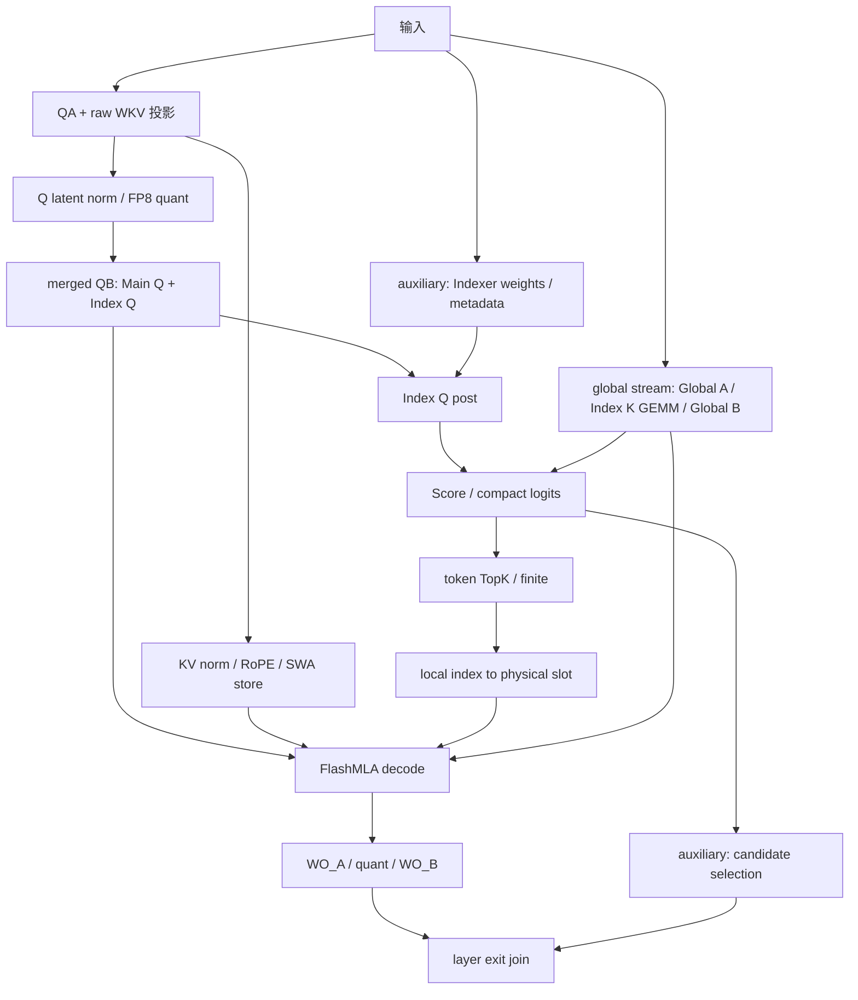

# DSv4.1 QB / KV / index 融合接入方案

评审日期：2026-10-20。目标分支 `guluguluhhhh/rtp-llm:full_layer_optimize`，
固定提交 `d6826d660d9cdd9989faa955b62295a25a83b442`。
对应 [PR #1532](https://github.com/alibaba/rtp-llm/pull/1532)，base 为
`feature/dsv41-dev-main-202161013`。

本文前六节保留最初评审时的设计与验收边界。实现已 rebase 到更新后的
`801eb19c34c4616c8ed387aafada185f879e00b9`；实际接入范围、当前测试和性能见
[dsv41_qb_kv_integration_results.md](dsv41_qb_kv_integration_results.md)。
新开关默认关闭，历史 N32768 结果不作为本分支的性能结论。

## 1. 结论与融合边界

可以移植我们的 warp-specialized GEMM / KV worker，但 FULL 路径不能原样套用
“Q GEMM + KV/cache + ready-index，3 kernel → 1 kernel”。

1. 此分支的 `MergedQB` 已经合并 Main Q 和 Index Q：
   `K=1280, N=32768+4096=36864`。我们的最终测量是 `N=32768`。
2. FULL1/FULL2 的当前层 TopK 依赖这次 merged QB 的 Index Q 输出。
   把 TopK conversion 放进同一次 QB launch，会形成循环依赖。
3. 因此 FULL 第一阶段做 **merged QB + KV/cache，2 → 1**；
   另将 **TopK finite 后处理 + conversion，2 → 1**。
4. TopK 已由前层给出的 REUSE 路径，再独立接入原来的 **Q + KV/cache + conversion，3 → 1**。
   必须确认 TopK 在 launch 前就绪、目标 cache/table 和请求映射属于当前 forward。
   REINDEX 仍需要当前层 Index Q，不能因复用了 KV 就当成 ready-index。

FULL 的阻塞关系来自
`decode/full_overlap.py::try_full_decode` 和
`attention_v41.py::_select_indices_decode`：



图中的 KV 数学输入来自 QA 分支；当前代码在 QB 后启动 KV。
合并后 QB 与 KV 由一个 kernel 的独立 warp 处理，Index Q/Score/TopK 的先后关系不变。
不能让常驻 QB CTA 自旋等待下游 TopK；即使使用另一 stream，也不能消除循环依赖。

## 2. 已核对的接口与差异

| 项目 | 当前分支 | 移植要求 |
| --- | --- | --- |
| QB 权重 | `MergedQB.weight=[36864,1280]`，前 32768 行已做 FlashMLA permutation，后 4096 行是普通 Index Q | 直接使用共享权重，保留 reload/view 所有权；不重新拼接或重排 |
| QB scale | int32 packed UE8M0，MN-major / TMA-compatible | 直接使用 `MergedQB.weight_scales`，检查 stride、alignment；不引入逐步转换 |
| Q latent | `try_project_quantized_qkv` 返回 BF16 qr、strided raw KV、FP8 qr + packed SF | 使用现有 FP8 qr/SF；不增加 quant kernel；不改变 BF16 qr 给 fallback 的语义 |
| QB 输出 | 同一 BF16 `[B,S,36864]` buffer 的 Main Q / Index Q views | Main Q row stride 为 36864；保留 strided view，不用 `.contiguous()` 隐藏 copy |
| Q norm / RoPE | V4.1 跳过 post-Q norm，Mega consumer 内做 Q RoPE | producer 不再做 Q RoPE；Q latent 的 norm/quant 仍保留 |
| raw KV | QA+WKV 投影的后 512 列，可非连续行 stride | 支持现有 row stride；不单独复制 raw KV |
| SWA | uint8 `[pages,entries,528]`，page 可 padding | 保留 byte layout、page stride、negative slot 跳过和 debug trap 语义 |
| GLOBAL / INDEX_K | GLOBAL FP4 288B；INDEX_K FP4 68B，可有物理页/逻辑页差异 | KV worker 只写 SWA；不替代 global compressor 或 INDEX_K producer |
| 频率 | `freqs_cis` complex64 `[P,32]`，decode 已提供 gathered frequencies | KV 可用零复制 float view `[P,64]`；返回调用者现有 gathered tensor，不丢 `DecodeQKV.freqs_cis` |
| slot / position | target gate 接受 int32/int64 metadata；原型 slots 只接受 int64 | native adapter 支持对应 dtype 或明确 fallback；新增转换必须纳入计时 |
| Flash 接口 | `flash_mla.cuda` pybind；decode 调 `fused_norm_rope_attn_rope_cast_decode` | 保留现有 backend 和输出 ABI；不能拿实验版 torch JIT consumer 覆盖生产模块 |
| GPU | 分支支持更宽 SM10x/TP envelope；原型只在 runtime `(10,3)` / 148 SM 测试 | 初始 native dispatch 只放行已验证 capability/geometry；其它走原路径 |

目前实测 M 是 `128/192/256/384/512`，这里的 M 是 **B×S token rows**，不是必然等于
请求 batch。M128/192/384 保留旧 swap family；M256/512 是 non-swap BN224、
双 accumulator、6 TMA stages、B payload `EVICT_FIRST`。
这些配置是移植候选，不是 `N=36864` 的已验证配置。

BN224 时，N32768 的 N tiles 是 147，N36864 是 165。
若 M512 使用 74 个 clusters，task 数从 294 增为 330，最大 task/cluster
从 4 增为 5；M256 从 147 增为 165，最大从 2 增为 3。
因此必须重新比较 pure merged GEMM，不能从“N 只增加 12.5%”推断延迟。

## 3. 建议按四个提交实施

### 提交 A：native kernel 和 pure merged-QB 对照

新增 `rtp_llm/models_py/bindings/cuda/kernels/dsv41_qb_kv.{h,cu}`
及专用内部 headers；在对应 `kernels/BUILD`、`bindings/cuda/BUILD`
和算子注册位置增加可选 CUDA13/SM103a target。
CPU/ROCm/不支持的 CUDA 构建不链接该实现。

把 `cache_v8/q_fused.cu`、`nonswap_mma.cuh`、`q_swap.cuh`、
`side_workers.cuh` 和实际需要的 instruction wrappers 整理为一个 native backend。
保留来源 revision；去掉实验 pybind、trace 默认路径、绝对 include/compiler 路径，
以及依赖 sibling `pdl_v5` JIT module 的加载方式。
CUTLASS 必须固定并验证兼容版本，不能假定仓库已有版本与实验 headers 完全相同。
新增 kernel 单独配置数值相关编译选项，不能直接继承全局 fast-math 后假定 cache 字节相同。

先提供 pure GEMM 接口，使用与 `MergedQB.forward_quantized` 完全相同的
FP8/SF 输入、共享权重、BF16 combined output。同步验证两段输出，而非只看 Main Q。
从 N36864 的 tile 数/cluster waves 出发调 geometry、cluster 数、epilogue 和
cache hint；以本分支实际安装 DeepGEMM 为性能 baseline。
原型支持 N 的检查通过不代表 N36864 已测过正确性或性能。

纯 merged GEMM 达到配对复测中的 baseline 水平后，才启用 KV 融合。
小 M 或非整 tile 不合适时按 shape fallback，不要求为减少 kernel 数强行替换。

### 提交 B：FULL merged-QB + SWA producer，2 → 1

新增 Python adapter `fp8/_v41_qb_kv.py`，其 `try_*` 在所有 gate 检查通过前
不得改写输出/cache。建议新开关 `DSV41_FUSED_QB_KV=0`，最初默认关闭。
native launch 接口为以下逻辑契约，tensor 输出由调用者提供：

```text
qb_kv_out(
  qr_fp8, qr_sf, merged_weight, merged_sf, combined_q_out,
  raw_kv, kv_norm, positions, frequencies, swa_pool, swa_slots, kv_out,
  eps, wait_qnorm_pdl, launch_config
)
```

native 接口显式传入 launch 配置和 PDL 参数，取消原型的 process-global
`set_pdl` 状态；所有 device guard、current stream、shape/stride/dtype、alias、
SM/cluster/SMEM 约束在 launch 前检查。warmup/build 均在 capture 外完成。

接入点：`decode/compute_qkv.py::decode_compute_qkv`。
在已拿到 `qr_quantized` 和 `raw_kv`、尚未调用 `merged.forward_quantized`
的位置尝试 adapter；成功返回同一 `DecodeQKV` 契约：

```text
qr = 原 BF16 qr
q = combined_q_out 的前 32768 列，unflatten 为 H64/D512
index_q = combined_q_out 的后 4096 列
kv = kv_out
freqs_cis = 调用者已有 freqs_cis
qr_quantized = 原 FP8 qr/SF
swa_written = True
```

只允许完整取代 `merged QB + try_fused_qkv_rope_cache` 的已支持路径；
adapter 返回 None 时继续原分支，不能先写 SWA 再 fallback。
`full_overlap.py` 的 global/auxiliary fork、wait、candidate overlap 和
异常路径 `finish()` 保持原语义；Index Q 后处理直接使用新输出 view。
raw KV 如需独立 WKV 投影，必须在 fused launch 前完成；首版可只接入现有
QA+WKV fusion 成功的情况，其他走 fallback。

KV 独立 warp 与 Tensor Core pipeline 并行，移植现有 4 KV warp/CTA 分工作为候选。
N36864 必须重新测 resource footprint 和 tail；不能因为少了独立 KV kernel
就认为在三流竞争下 FULL 更快。

### 提交 C：FULL TopK finite + physical-slot translation，2 → 1

接入点是 `_v41_decode_topk.py::_finite_topk_kernel`，不是 QB。
这个 kernel 当前位于 DeepSelect/topk_v3 之后，已经要读 logits、lengths、
selected indices 并执行 finite mask；在这个 publication point 追加 block-table
lookup 和 global-slot store，不改 TopK selection backend。

必须同时保留两份输出：

- `local_topk`：维持现有 short-row ascending、finite mask、-1 和
  `_shared_attention["topk"]` 的语义，后层 REUSE 继续消费它。
- `global_slots`：当前层 attention 使用，不能反过来覆盖 shared local indices。

建议新内部入口 `select_tokens_with_slots(...)` 返回
`(local_topk, global_slots_or_none)`；现有 `select_tokens` 保留原契约。
仅在 batched paged TopK 和原 `_decode_global_slots` fast-path 同样支持的布局启用。
`_select_indices_decode`/FULL 调用者通过显式 forward-local result 传递 slots；
不支持时仍运行原转换，不使用 data_ptr 相同就跨 forward 复用旧 slot 内容。

沿用 `_decode_global_slots` 的当前 gate：non-sharded、int32 metadata、
`raw_tpb % compress_ratio == 0`、`pool.entries == raw_tpb/compress_ratio`。
传入的是压缩后的逻辑 entries，不是直接拿 raw token block coverage。
公式与原实现保持一致：

```text
block = local // logical_entries
slot = table[request, block] * physical_entries + local % physical_entries
local < 0 / block 越界 / base <= 0  => -1
```

CP、特殊布局、非 batched selection 等路径维持原 `_decode_global_slots`。
候选 selection 仍只读 logits，在 auxiliary stream 上与当前层后半段并行。
这一步额外消掉 conversion launch，FULL DAG 仍然没有 QB→TopK 的循环。

### 提交 D：独立扩展 ready-index 的 3 → 1 路径

在已确认 TopK 由前层产生的 REUSE decode 中，producer 可以同时接收
当前 SWA raw KV 和已就绪 local TopK，使用我们的 index team 做物理映射。
需要适配当前层 GLOBAL table/entries/request 映射，并保留 local TopK。
这属于另一种调用拓扑，单独开关/测试/报告，不能宣称提交 B 已经覆盖。
SWA-only 则只做 Q+KV，2 → 1，没有 GLOBAL conversion。

## 4. PDL 的接入限制

此分支当前 PDL 只覆盖 **Q latent norm/quant → merged QB**。
`_qb_pdl_enabled` 同时检查开关和 `deep_gemm.get_pdl()`，不改库的全局策略。
保留这一行为作为原路径对照；新 consumer 需要对应 launch attribute 和
在读取 qr/SF 前执行 GDC wait，不能只保留上游 early trigger。

原型把 incoming wait 和 outgoing trigger 绑在同一个 `use_pdl`；生产移植应拆开。
第一阶段只接已有 incoming edge，后续 kernel 仍按普通完成依赖消费新 producer。
可以单独评估把独立 descriptor/shared/TMEM 初始化放到 wait 前，但所有输入读取
和 side worker 都必须位于安全依赖边之后。

不要在这一 PR 加入实验版 Flash consumer 的 PDL 改动：原实验同时修改过
Q/index 的 coherent loads 和 consumer 的 GDC wait；这些不是 target Flash wheel
已经具备该协议的证据。FULL 中 QB 与 MLA 之间还有 Index Q/Score/TopK 和 stream
joins，原型紧邻 producer→attention 的 programmatic chain 也不是这里的 DAG。
后续确需改 FlashMLA 时，另做 backend 版本/API 和 graph-edge 审计。

## 5. 验收与测量

以下是原评审定义的验收项；当前已完成与未完成的项目以实施记录为准。

1. **锁定基线**：branch SHA、RTP native libs、DeepGEMM/FlashMLA binary/SHA、
   compiler、CUTLASS、runtime capability 与 SM 数。保留默认三流和 QB PDL 对照，
   单独记录 WO_A fused quant 是否启用，不用旧环境的延迟替代新分支 baseline。
2. **正确性**：N36864 的 Main/Index Q 各自对照；Q 使用锁定官方 DeepGEMM
   `calc_diff`，cache/index 精确检查，attention 使用目标官方容差。
   norm/RoPE 的 FMA/rounding、padding、mask、debug trap 行为均以目标提交为准。
3. **输入覆盖**：M128/192/256/384/512、B64/S6、两个压缩比、decode S1 和 S>1、
   tile/dispatch 相邻形状、strided raw KV/merged Q、page padding、负 slots、
   block 0、短上下文、candidate holes、非连续 req-id、权重 reload。
   非已验证形状、TP/CP 和 unsupported layout 必须正确 fallback。
4. **Graph**：eager 与 Graph 对照；同地址修改 qr/raw KV/positions/slots/TopK 后
   重放，poison 输出再验证。不得 capture 内 JIT/load；nondefault stream、
   fork/join、输出 lifetime 和异常路径必须覆盖。检查实际 Qnorm→QB programmatic
   edge 和侧流 joins，不能套用原型串行链的“总边数必须 n−1”。
5. **性能分组**：分别比较 pure merged GEMM、QB+KV 的 2→1 区间、
   finite+conversion 的 2→1 区间、完整 FULL 三流调用。
   REUSE 的 3→1 另列，区间不含 attention；FULL 中不能把等待 Score/TopK 的长跨度
   标成原来独立三 kernel 的纯 producer 开销。
6. **指标**：CUDA Graph warmed replay，30 samples，每个样本
   `8 GB flush → 1 replay → fence`；所有参与流的生产 activities 以
   `max(end)-min(start)` 计算包络，保留 trace 与原始样本。
   单 kernel 用 activity duration；PDL 生命周期含 wait 时单独说明。
   不求和各 kernel median，不用 event replay train 代替 exact envelope。
   现有 `dsv41_full_decode_pdl.py` 的 event timing 可作单列诊断，需扩展 CUPTI
   replay association/跨流 activities 后才能与我们已有指标直接比较。
7. **配对复测**：反向候选顺序至少两轮。小 M 和 B64/S6 同样独立验收；
   只有通过的 shape 才加入新 dispatch，原路径始终可选。完整 FULL 的收益还要确认
   不被新增 resource contention、Index Q 或 attention 延迟抵消。

优先扩展现有 `test_v41_merged_qb`、`test_v41_decode_qkv_integration`、
`test_v41_qkv_rope_cache`、`test_v41_global_overlap`、`test_v41_decode_topk`、
`test_v41_decode_preprocessing`。同时补齐这些新 CUDA case 在 x86 SM103 的 BUILD
可执行范围；当前 `_X86_TESTS` 没有覆盖所有相关 suite，不能以 skip 当作通过。

## 6. 提交与发布顺序

建议 #1532 保持现有调度/metadata/minimal-PDL 范围，新 native producer 作为后续 PR
或同分支明确分开的提交。A→B→C 顺序方便逐段 rollback 和证明收益，D 单独扩展。
每步使用当前分支 baseline，不能直接把实验旧目录和历史数据整体复制进产品代码。

另外，当前 #1532 PR 描述仍写 multistream / QB PDL “default off”，但此 head
及随附文档已经是 default on；发布前应同步这两处描述。此评审没有修改线上 PR。
