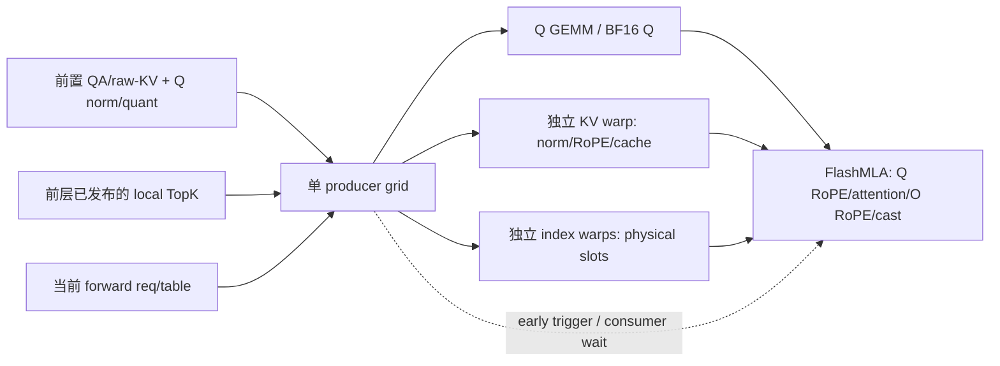

# V4.1 REUSE Q/KV/index 3→1 + FlashMLA PDL 接入

> 后续无 Bazel 的完整 attention 计算链验证、上游 PDL visibility 修复和目标分支
> FlashMLA wheel 对照，见 [完整 attention 验证](dsv41_whole_attention_validation.md)。
> 本文保留前一轮孤立 producer/consumer 的测量与当时的验收边界。

2026-10-21。分支 `codex/dsv41-qkv-integration-review`，基于
`guluguluhhhh/full_layer_optimize@801eb19c34c4616c8ed387aafada185f879e00b9`。

已接入原来的 **Q up-projection GEMM + KV norm/RoPE/cache + ready-index mapping，
3 kernel → 1 kernel**，再通过显式 PDL 边接 source-pinned native FlashMLA。
两轮五档 M 的 3→1 区间均缩短，PDL-on 完整链缩短 **1.8%–5.2%**。
PDL 额外收益不稳定，M128 的 PDL-off 完整链仍略慢；保留独立开关。
这是精确 native TU 和 decode 接线的 GPU 验证；整包 Bazel、完整模型和整层尚未验收。

## 路由与实现



- `decode/ready_qkv.py` 检查 REUSE、ready TopK、请求/表/页几何及 runtime SM103/148 SM。
  `decode_compute_qkv` 用现有 Q-only N32768 权重/SF 直接调用 native producer。
  `attention_v41.py` 使用返回的 physical slots，跳过原 conversion；共享 local TopK 不改写。
  不缓存跨 forward 的 device 值或 pointer-plan。positions 转换放在 producer 之前。
- swap M128/BM128、M192/384/BM192 使用 64 clusters、512 threads：1 KV warp、8 index warps。
  non-swap M256/512 使用 BM256/BN224、74 clusters、512 threads、双 accumulator stage：
  4 KV warps、5 index warps。GEMM/KV/index 可独立推进；没有用全 kernel 差值伪造内部时长。
- Incoming Qnorm PDL 与 outgoing FlashMLA PDL 分别传参，无全局开关。
  producer 每 CTA 在 cluster 初始化后 trigger；consumer 初始化 barrier/TMEM 后、
  读取 Q/cache/indices 之前 GDC wait。Q/index 使用 coherent global loads。
- native FlashMLA 单独固定官方源码 `0f11e178da1f67becb087a324b400854931ec3e3`，
  CUTLASS 子模块 `4faf1a1568cf1e4ad8ff71846a13e16f2a6a6f6b`，私有命名空间、独立参数 ABI。
  producer 继续用 RTP 原 CUTLASS `dc4817921edda44a549197ff3a9dcf5df0636e7b`。
  生产全部是 Bazel native target；GPU torch-extension loader 仅为测试桥。

| 开关 | 默认 | 作用 |
| --- | --- | --- |
| `DSV41_FUSED_READY_QKV` | 0 | 开启 REUSE Q/KV/index 3→1 |
| `DSV41_READY_FLASHMLA_PDL` | 1 | 已准入的 REUSE 路由中使用 native PDL consumer；0 用原 wheel |

FULL 当前 TopK 依赖本层 Index Q；Reindex 也不能按 ready-index 处理，均不进入新路由。
unsupported M/layout/metadata、sharded CP、旧 native 库缺少新接口时走原路径，
在任何新 cache 写入前退出准入。FULL 的 N36864 路由及结果见
[前一阶段记录](dsv41_qb_kv_integration_results.md)。

## 正确性与 Graph 边

精确源文件重新编译后，**14 tests，0 failures/errors/skips**：原 QB/KV 7 项、
TopK/slots 3 项、新 ready-QKV 4 项。覆盖：

- M128/192/256/384/512，K512/2048，int32/int64 positions/write slots，entries64/128，
  strided raw KV、padded cache pages、padded table/local-TopK rows、invalid token/block/base。
  Q 与目标 DG、KV/cache 与目标 Triton、slots 与原 translator 均精确一致。
- 同地址修改输入、权重、positions、write slots、req、TopK、table，poison 输出后 Graph replay；
  producer 三阶段、PDL consumer 四阶段，精确一致且 local TopK 不被覆写。
- 实际 `decode_compute_qkv` → `MegaAttention.decode` → native consumer 接线，
  B128×S1 与 B64×S2、compression ratio1/2。保留 qr/freqs identity 和 SWA-written 契约。
  native Graph inspector 验证 **2 kernel nodes、1 条 programmatic edge**。
  基线为4节点/0条 PDL边，fused-off为2节点/0条；不以 Python flag 推断 PDL。
- patched native consumer 对同源码未修改的官方 FlashMLA wheel：所有 M 的
  dequantized output `calc_diff=0`，LSE `max_abs=0`。未将它写成任意版本 wheel 的等价结论。

## 性能口径

PyTorch runtime capability `(10,3)`，148 SM，torch2.11.0+cu130，nvcc13.2，
共享 GPU、未锁频。目标 DeepGEMM2.8.2+ad62a90（隔离依赖副本，非替换全局安装）。
官方 testing 固定 `559d79fb6994a58b8a15b4b93bf13ccc16edf247`，验证 origin/HEAD/clean files。

输入是已量化 qr、raw KV 和 ready TopK；不含 QA/front norm-quant、压缩、WO 或整层。
baseline = DG + 目标 Triton KV/cache + 原 translator + 同一 patched native FlashMLA（PDL off）；
fused off/on = 新 producer + 同一 native consumer。该等 binary 对照隔离融合/PDL变化，
**不等同于目标分支安装的另一版 FlashMLA wheel 的完整生产基线**。

3次 callable warmup、capture一次完整调用、20次 replay warmup；每样本
`8GB flush → 1 Graph replay → fence`，30 samples。CUPTI activity记录完整 kernel签名，
包络=`max(end)-min(start)`，不含flush/JIT/提交/同步，单位μs、统计为median。
3→1前缀从同一完整链trace取前3/前1个kernel的实际包络；不做kernel median相加。
A正序，B反序；两轮源码及producer/consumer binary SHA完全相同。

### 原 3-kernel 区间

| M | A：3 kernel → 1（PDL on）| B：3 kernel → 1（PDL on）| 区间缩短 |
| --- | --- | --- | --- |
| 128 | 18.017 → 17.024 | 18.320 → 16.944 | 5.5%–7.5% |
| 192 | 19.632 → 17.408 | 19.776 → 17.552 | 11.2%–11.3% |
| 256 | 20.160 → 17.264 | 20.096 → 16.720 | 14.4%–16.8% |
| 384 | 24.000 → 20.992 | 24.145 → 21.104 | 12.5%–12.6% |
| 512 | 27.040 → 22.752 | 27.136 → 22.896 | 15.6%–15.9% |

### 接上 FlashMLA 的完整区间：4→2

| M | A：baseline / fused off / fused on | B：baseline / fused off / fused on | on 相对 baseline 缩短 |
| --- | --- | --- | --- |
| 128 | 40.016 / 40.528 / 39.312 | 40.080 / 40.176 / 39.057 | 1.8%–2.6% |
| 192 | 56.752 / 55.632 / 54.881 | 56.784 / 55.744 / 55.376 | 2.5%–3.3% |
| 256 | 57.568 / 55.745 / 55.761 | 57.473 / 55.072 / 54.481 | 3.1%–5.2% |
| 384 | 76.161 / 74.193 / 73.552 | 76.673 / 74.385 / 74.368 | 3.0%–3.4% |
| 512 | 94.161 / 90.352 / 91.137 | 94.193 / 90.336 / 90.369 | 3.2%–4.1% |

M128 PDL-off 完整链 A 慢0.511μs、B慢0.096μs，尽管3→1前缀变快。
consumer/cache/execution-state 影响仍可能抵消小幅前缀收益，未有硬件计数器支持进一步归因。
M512 PDL-on 比off在A慢0.785μs、B慢0.032μs；M256在A也无额外收益。
不能把 PDL 当作所有M的稳定加速，更不能用重叠区间长度直接当净节省。

### PDL 重叠边界

| M | PDL 两 grid 包络交集 A / B（μs）|
| --- | --- |
| 128 | 14.816 / 14.688 |
| 192 | 15.265 / 15.344 |
| 256 | 4.640 / 4.384 |
| 384 | 18.801 / 18.881 |
| 512 | 3.312 / 3.584 |

这里是 profiler 中两个 **grid activity区间的交集**，包括consumer setup和GDC等待；
不代表attention有效计算与GEMM重叠同样长，也不是fused内部GEMM/KV/index的测量。
[交互timeline](dsv41_ready_qkv_timeline.html) 展示真实样本边界和30样本统计；
没有给未插桩的producer内部子操作虚构时长。

## 接入时发现并修复的退化

最初移植遗漏了swap原实验的独立8-warp index team，把mapping串在KV warp后面。
首轮M192前缀19.824→26.113μs，M384为24.112→37.216μs，确有退化。
只恢复power-of-two移位、每lane8个独立lookup并不能消除退化；补回index team后，
上述正反两轮均恢复收益。诊断轮`results_a_r2/results_shift_a`全部保留，未混入最终统计。

## 复现与剩余验收

匹配源码的RTP CUDA13环境：

```bash
bazel test --config=cuda13 \
  //rtp_llm/models_py/modules/dsv41/fp8/test:test_v41_qb_kv_x86 \
  //rtp_llm/models_py/modules/dsv41/fp8/test:test_v41_topk_slots_x86 \
  //rtp_llm/models_py/modules/dsv41/fp8/test:test_v41_ready_qkv_x86

export DSV41_FUSED_READY_QKV=1
export DSV41_READY_FLASHMLA_PDL=1
```

本机远端容器没有Bazel，已装RTP native wheel缺少新分支的`HiddenStateCaptureDtype`。
GPU验收使用精确TU测试桥，query/front/selector仅隔离原函数AST的依赖导入；
decode接线测试前置projection用stand-in，新producer/consumer实际在GPU执行。
尚需完整Bazel包构建、与目标分支wheel的整层对照、真实模型准确性/权重reload、
三流decode、TP/CP等配置验收。因此新总开关保持默认关闭。

随附 [JSON锁和原始样本索引](dsv41_ready_qkv_integration_results.json) 包含源码、binary、
Graph edge、原始trace/metrics SHA及全部样本。完整测试桥、命令脚本、日志、CUPTI trace保留于：

- 本地 `experiments/dsv41_q_attn_fusion/integration_v11/`；最终轮次 `results_teams_a/b`。
- `sm103-0:/home/zhouzhenxiang.zzx/dsv41-official-baseline-20261019/integration_v11/`。

运行测试桥需设置`RTP_QB_SOURCE_ROOT`为源码overlay，沿用锁定依赖，执行`run_tests.py`；
性能执行`qualify.py --out NEW_DIRECTORY`，第二轮加`--reverse`。
这些桥接脚本不属于生产import路径；未执行的Bazel/full-model检查不记为通过。
